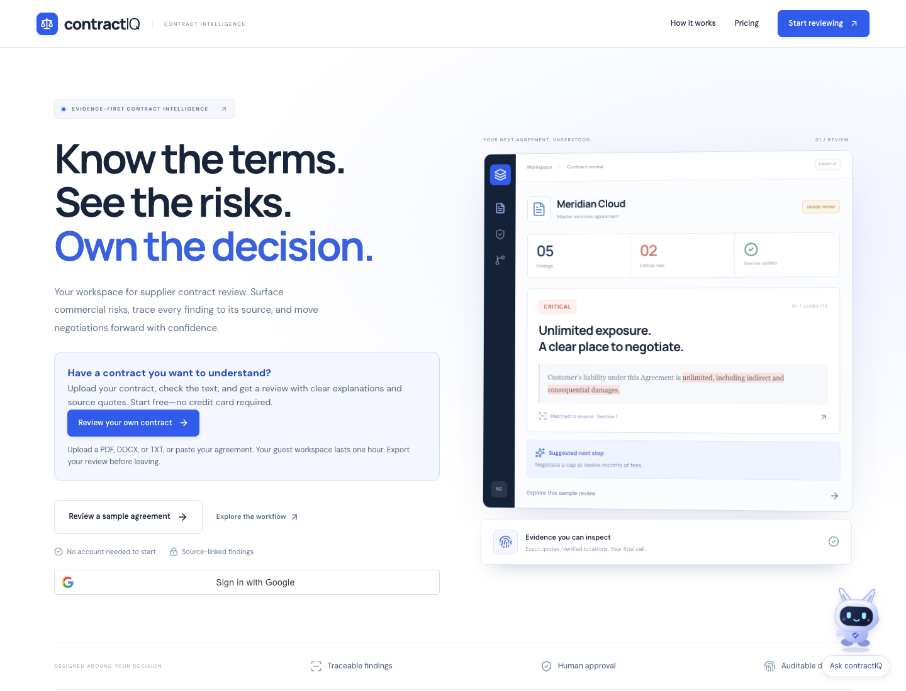
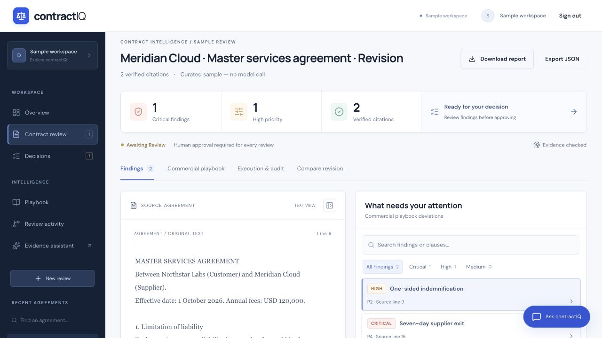
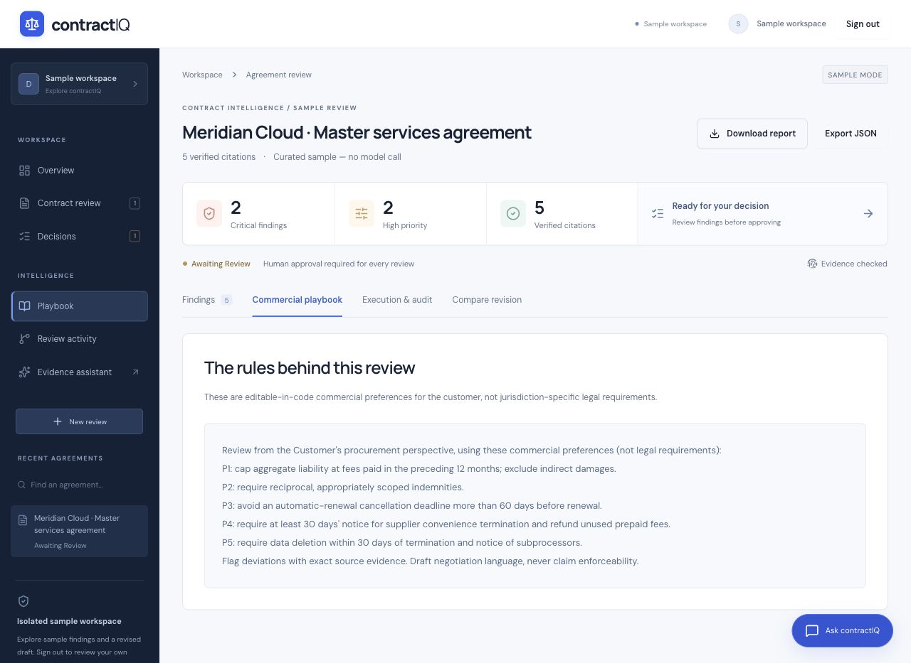
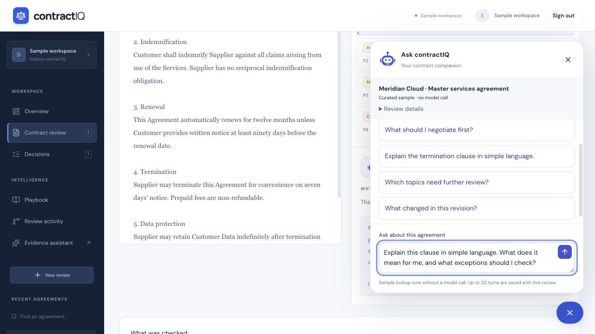
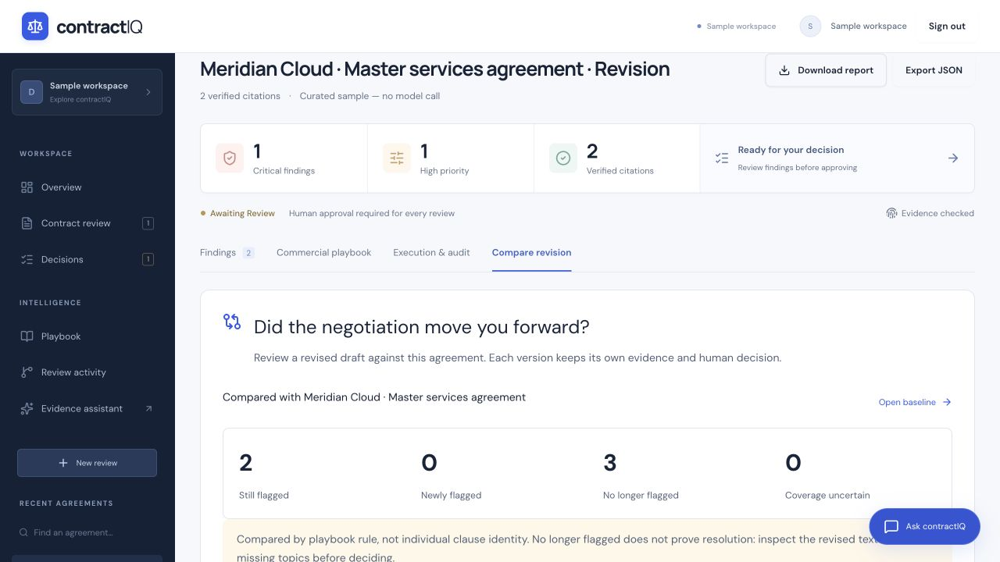
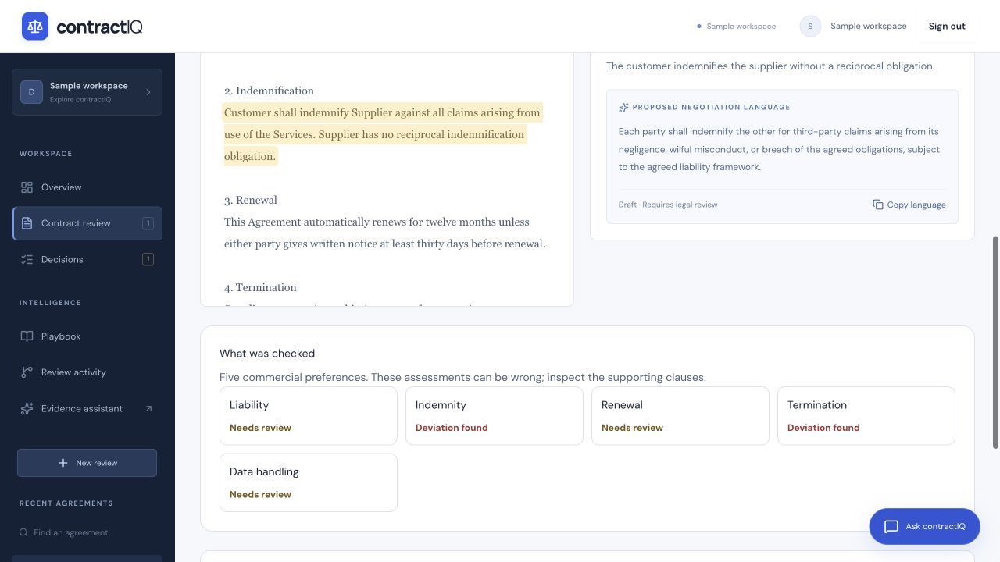
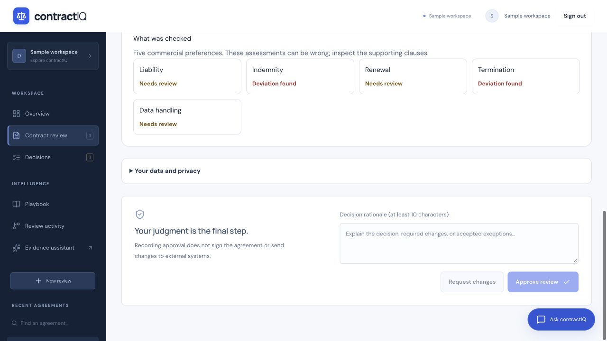
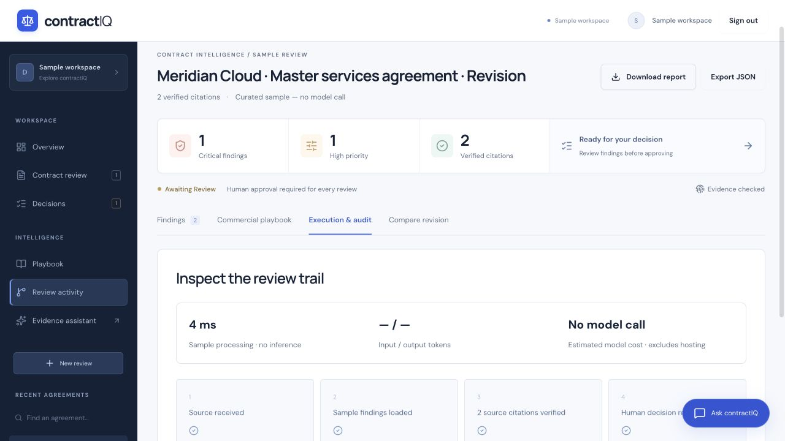

# contractIQ: AI Powered Contract Intelligence & Evidence-Based Review

[](https://contractiq-frontend-2e3u.onrender.com/)
[](https://nextjs.org/)
[](https://www.typescriptlang.org/)
[](https://fastapi.tiangolo.com/)
[](https://www.python.org/)
[](https://www.sqlite.org/)

**Live Application:** [contractIQ](https://contractiq-frontend-2e3u.onrender.com/)

contractIQ is a full-stack AI contract intelligence platform that combines **commercial playbook review**, document extraction, contract passage retrieval, cited answers, revision comparison and human approval.

Procurement teams can upload supplier agreements, inspect the clauses behind each finding, ask questions about the selected contract and compare a negotiated draft before recording a decision.

> Turn a supplier agreement into a review you can inspect, discuss and act on.

---

## Product Walkthrough

The latest desktop screenshot below was captured from the live deployment on 15 October 2026. The workflow screenshots that follow use synthetic agreements in the **curated sample workspace**. Sample findings are prepared and do not call a model. Live review of your own agreement uses the configured AI provider.

### Current Live Product



The landing page offers a direct path to review a user's own contract, an optional sample walkthrough, Google sign-in, and the contractIQ assistant.

### 1. Inspect the Agreement and Its Findings



The agreement sits beside its findings, with severity filters and source line references. Select a finding to inspect the exact clause, understand its commercial impact and review proposed negotiation language. In this revised sample, indemnity and termination still require attention.

### 2. Understand What the Review Checks



The commercial playbook makes the review criteria visible: liability, indemnity, renewal, termination and data handling. These are procurement preferences that guide the assessment. They are editable in code and do not represent jurisdiction-specific legal requirements.

### 3. Ask Questions and Open the Evidence



Ask about the selected agreement without searching through every paragraph. The assistant opens cited passages and preserves a conversation for that review. The bot companion offers suggested questions and an **Explain this clause** shortcut beside each finding. The screenshot shows an editable explanation request tied to the liability clause. In live mode, model answers are checked for valid source references; proposed wording remains a draft.

### 4. Compare a Negotiated Revision



Compare a new draft with the original agreement. This synthetic revision has two rules still flagged and three no longer flagged. Below the summary, before-and-after passages show the wording changes. Each version keeps its own evidence and decision; a disappearing finding does not by itself prove the issue is resolved.

### 5. Check Coverage and Uncertainty



Coverage helps distinguish a deviation from an unresolved assessment. The revised sample marks several topics **Needs review** rather than treating the absence of a finding as confirmation. Inspect the clauses and exceptions before accepting the suggested wording.

### 6. Record a Human Decision



The reviewer supplies a reason before approving the review or requesting changes. Approval records a decision; it does not sign the agreement or send anything to the supplier. Download the report or JSON bundle to retain the agreement, evidence and decision record.

### 7. Inspect the Review Trail



The execution view shows the processing steps, timing and available usage information. Sample mode explicitly reports **No model call**. The audit history provides local hash-chain consistency checks; it is not an externally anchored or tamper-proof record.

### Try the Product

- **Review your own agreement:** enter a free guest workspace or sign in with Google, upload PDF/DOCX/TXT or paste text, inspect the extraction and run AI review.
- **Explore the sample:** use a separate curated agreement with prepared findings. Sample mode is clearly marked and makes no model call.
- **Compare and decide:** upload a revised agreement, inspect changes, record a decision with a reason and export the review.

Early access has no subscription or credit-card requirement. The host supplies AI access, subject to provider quotas and application usage limits.

---

## Architecture

```text
                 PDF / DOCX / TXT / Pasted Contract
                                |
                                v
                    Text Extraction & Preview
                                |
                                v
                       FastAPI Review API
                                |
             +------------------+------------------+
             |                  |                  |
             v                  v                  v
      Playbook Review    Passage Retrieval    Revision Comparison
             |                  |                  |
             v                  v                  v
      AI Assessments      AI Answer + Draft   Text & Finding Changes
             |                  |                  |
             +------------------+------------------+
                                |
                                v
                  Schema & Source Validation
                                |
                                v
                     Next.js Review Workspace
                                |
                                v
                    Human Decision & Rationale
                                |
                                v
                  SQLite / Audit / Report / JSON
```

The frontend and API are served together from one origin. Review history, conversations and decisions belong to the authenticated session or Google identity.

## AI Review Pipeline

```text
Contract Text + Five Commercial Preferences
                     |
                     v
              Model Assessment
                     |
                     v
       Schema & Exact Quotation Checks
                     |
                     v
 Findings + Suggested Wording + Topic Coverage
                     |
                     v
        Source Inspection & Human Decision
```

### Commercial Playbook

The review checks five explicit procurement preferences:

| Topic | What the reviewer inspects |
| --- | --- |
| Liability | Exposure, liability limits and consequential damages |
| Indemnity | Scope and reciprocity of indemnification obligations |
| Renewal | Automatic renewal and cancellation notice |
| Termination | Supplier convenience termination and prepaid-fee treatment |
| Data handling | Deletion commitments and subprocessor notice |

Coverage distinguishes a deviation, a matching clause, an absent topic and uncertainty. These are commercial preferences; the product does not certify jurisdictional legal compliance.

### Document-Grounded Question Answering

The dashboard assistant retrieves passages from the selected agreement using lexical matching, term aliases and nearby context. Comparison questions can retrieve the linked baseline with explicit version labels.

```text
User Question + Selected Agreement
                  |
                  v
          Ranked Source Passages
                  |
                  v
            AI Answer Generation
                  |
                  v
       Schema & Citation-ID Validation
                  |
                  v
       Answer + Clickable Sources + Limits
```

The assistant can answer questions about clauses outside the flagged findings, explain conflicting terms and propose negotiation wording. Proposed wording is displayed as a draft requiring review. Up to 20 conversation turns are stored per agreement; the previous question helps resolve short follow-ups.

When relevant evidence cannot be retrieved or supported, the assistant returns an insufficient-evidence response. Invalid model answers are rejected, with one bounded regeneration attempt.

### Source Transparency

Findings use exact quotations with server-computed text offsets and line numbers. Assistant citations identify source passages and the current or baseline version. Returned source IDs are checked against the retrieved context.

Exact quotations establish where text came from. They do not prove that every interpretation is correct; citation validation does not verify semantic entailment.

## Key Capabilities

### Document Upload & Processing

Searchable PDF, Word `.docx`, UTF-8 `.txt` and pasted text are supported. Extraction happens before AI review so users can inspect the input. Limits are 5 MB, 60,000 extracted characters and 100 PDF pages. Scanned or locked PDFs are rejected; OCR is not implemented.

### Revision Comparison

A revised agreement is linked to its owned baseline. The workspace displays exact text changes and changes in flagged risks, with an independent decision for each version. A finding that is no longer flagged is not automatically considered resolved.

### Decisions & Audit History

Approval or a request for changes requires a rationale. Final decisions are atomic and immutable. Approval records the reviewer's decision; it does not sign the agreement or send changes externally. Audit records support local hash-chain consistency checks.

### Reports & Export

Download a printable HTML report or an authenticated JSON bundle containing the agreement, findings, comparison, playbook, decision, conversation and audit snapshot. Use browser Print → Save as PDF for a PDF copy.

### Authentication & Data Controls

Google sign-in provides a returning identity. Guest and sample sessions are isolated, expire after one hour and can be revoked by signing out. Guest access cannot be recovered after sign-out or closing the tab.

Users can delete active reviews, conversations and audit records. A baseline with linked revisions must have its revisions removed first. Session expiry does not automatically delete stored reviews; model-provider retention and backups are separate.

### Landing Assistant

A landing-page assistant explains the product and workflow before users enter the review workspace.

## Technology Stack

| Layer | Technologies |
| --- | --- |
| Frontend | Next.js App Router, React, TypeScript, CSS, Lucide icons |
| Backend | Python, FastAPI, Uvicorn, Pydantic, HTTPX |
| AI & Retrieval | Configurable compatible model API, commercial playbook assessments, lexical passage retrieval, source validation |
| Current verified provider | Groq · `openai/gpt-oss-120b` |
| Document processing | pypdf, bounded DOCX/XML parsing, UTF-8 text extraction |
| Authentication | Google identity verification, isolated guest/demo sessions |
| Storage | SQLite for reviews, conversations, decisions and audit records |
| Deployment | Docker, Render, GitHub Actions |

## Run Locally

Requires **Python 3.11+** and **Node.js 22.12+**.

```sh
python3 -m venv .venv
.venv/bin/pip install -r requirements-review.txt
npm --prefix src/frontend ci
npm --prefix src/frontend run build
./scripts/start-review.sh
```

Open [http://127.0.0.1:8017](http://127.0.0.1:8017). The curated walkthrough works without model credentials.

### AI Configuration

Set these privately in the server environment to enable real reviews:

| Variable | Groq configuration |
| --- | --- |
| `REVIEW_LLM_API_KEY` | Your private provider key |
| `REVIEW_LLM_BASE_URL` | `https://api.groq.com/openai/v1` |
| `REVIEW_LLM_MODEL` | `openai/gpt-oss-120b` |
| `REVIEW_JSON_SCHEMA` | `0` |

See [.env.review.example](.env.review.example) for configuration names and other provider examples. The source-run script loads a private `.env.review` file when present; exported environment variables take precedence. Copy `.env.review.example` to `.env.review` and set all three provider fields together. Use `REVIEW_ENV_FILE` to select another private file. Store keys only on the server and never commit them or place them in frontend variables.

For Google login, follow the [Google setup guide](docs/google-login-setup.md).

### Docker

```sh
# Configure .env privately using .env.review.example as a reference.
docker compose up --build
```

Compose reads `.env` or exported variables. A local named volume persists review data. `docker compose down` preserves that volume; `docker compose down -v` deletes it.

An optional local inference path is documented in [the pilot guide](docs/review-pilot.md). The tested small local model failed validation and is not the default provider.

## Testing & Evaluation

```sh
.venv/bin/pip install pytest pytest-asyncio ruff mypy
PYTHONPATH=src/agent .venv/bin/python -m pytest src/agent/tests/test_review*.py -q
npm --prefix src/frontend run test:unit
./scripts/demo.sh
```

The October 13 release verification recorded:

| Check | Result |
| --- | --- |
| Standalone backend tests | 94 passed |
| Frontend interaction tests | 22 passed |
| Production build, lint and backend type checks | Passed |
| Deployed sample workflow | 15 checks passed |
| Live Groq workflow | 17 checks passed |
| Six synthetic assistant cases | 6/6 after documented scoring correction |

The original assistant checker scored 5/6 because it omitted the conflict explanation shown in the limitation text. Both reports are preserved. These are small synthetic regression tests, not independent legal-expert validation or a production reliability estimate.

See the [QA report](docs/judging/qa-2026-10-13.md) and [evaluation results](evals/review/README.md). Run `python scripts/evaluate_assistant_api.py` to repeat the deployed synthetic assistant cases; it consumes provider quota. The older review corpus is validated with `PYTHONPATH=src/agent .venv/bin/python -m app.review.evaluate`; add `--live` for real model inference.

## Pricing & Business Model

Early access is free. Proposed plans are **$49/month for 50 reviews**, **$199/month for 300 reviews**, and enterprise pricing based on requirements. These are proposed plans; billing, willingness to pay and customer ROI have not been validated.

## Deployment

The live product runs on Render. Use [render.review.yaml](render.review.yaml) and [Dockerfile.review](Dockerfile.review) for a new full-stack deployment, or see [render.yaml](render.yaml) for the existing service configuration.

The current free Render service may sleep and its SQLite storage can reset on deployment. Export important reviews. It is not a durable contract repository. Provider free-tier quotas can interrupt AI usage. Manual backup/restore tooling is available for hosts with filesystem access; scheduled off-host backup is not claimed.

- [Deployment and configuration](docs/review-pilot.md)
- [Free hosting and data storage](docs/judging/free-hosting.md)
- [Final submission guide](docs/judging/final-submission.md)
- [Three-minute demo](docs/judging/demo-script.md)
- [Practitioner validation protocol](docs/judging/practitioner-validation.md)

## Project Scope

Organization roles, SSO, OCR, billing, automated retention and external business-system execution are not implemented. Practitioner feedback remains outstanding. A human must inspect the evidence and make the final decision.

The earlier .NET, Keycloak and LangGraph prototype is retained for reference, with its architecture in [legacy documentation](docs/legacy/prototype-architecture.md). It is outside the active runtime and has known unresolved validation failures. Current CI checks the standalone review product.

Codex assisted development and testing.

### Longer agreements

Live review processes long agreements in sections while retaining citations against the complete original text. The default is 9,000 characters per section with a 60-second pause between sections, intended for providers with small per-minute token allowances. A roughly 33,000-character agreement can take several minutes. Keep the page open during review.

Section analysis cannot reliably resolve definitions and exceptions across the whole agreement. Repeated or conflicting topic assessments are shown as uncertain and require human reconciliation; the app does not claim the agreement is compliant. Failed requests do not save a partial review.

Server operators can tune `REVIEW_SECTION_CHARS`, `REVIEW_MAX_OUTPUT_TOKENS`, and `REVIEW_SECTION_PAUSE` for their provider. Smaller sections reduce request size but increase the number of calls. These limits do not eliminate account-wide rate limits or guarantee support for every document.
