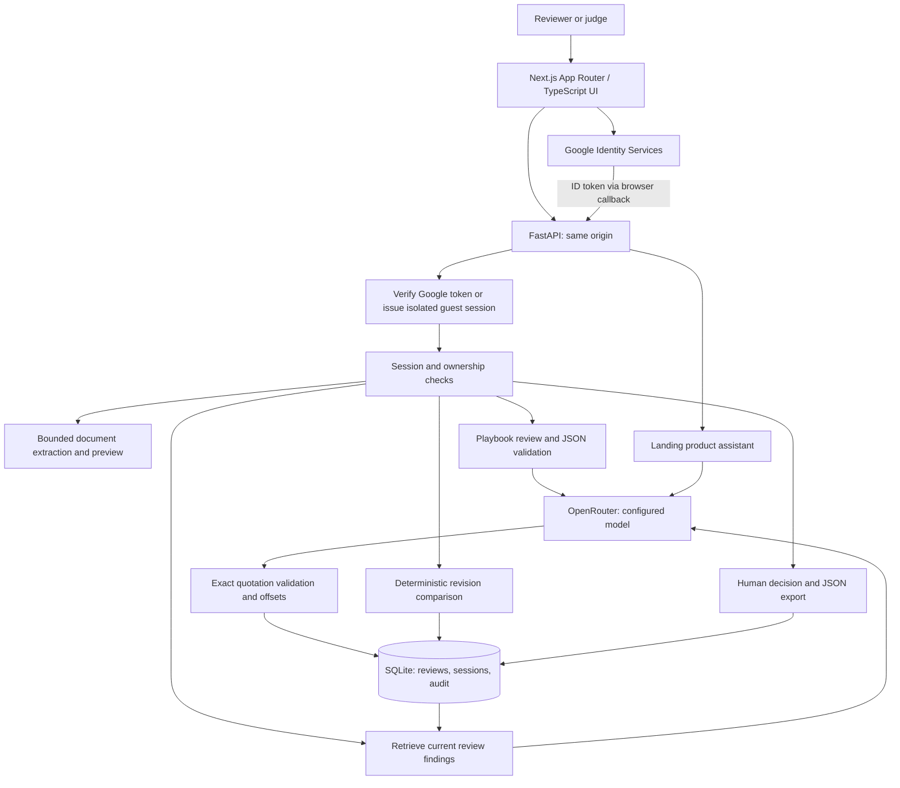

# ContractIQ — DeepSoft AI-FDE submission guide

**Turn supplier contracts into evidence-backed negotiation decisions.**

- Live product: https://contractiq-frontend-2e3u.onrender.com/
- Source: https://github.com/rajatmurhe/contractiq
- Category: Legal & Compliance / industry-specific AI
- Current status: deployed pilot; this is preparation material, not confirmation that a submission has been sent.

## Problem and customer

A procurement reviewer must determine which supplier terms deviate from the company's buying policy, find the supporting clauses, and check what changed in the next draft. Reading a summary alone does not answer those questions.

ContractIQ targets procurement leads at growing software companies handling recurring supplier agreements. Its initial playbook covers liability, indemnity, renewal, termination, and data handling. Users can upload their own documents, but the analysis remains scoped to these five commercial preferences; it is not universal legal review.

## Product workflow

1. Start free evaluation or use configured Google sign-in.
2. Upload a searchable PDF, DOCX, or TXT, or paste a contract. Preview and correct extracted text before AI analysis.
3. Review findings with exact source quotations, highlighted passages, explanations, and draft negotiation language.
4. Ask questions grounded in retrieved findings from the current review.
5. Upload or paste a revised agreement and inspect exact text changes and changes in flagged playbook rules.
6. Record a human decision with a reason. Export the review, source evidence, comparison, and audit information as JSON.

Judges pay nothing and need no credit card. The host funds model calls; per-session and global limits still apply. The separate sample walkthrough is explicitly curated and does not call a model.

## Alignment with the judging criteria

| Criterion | Implementation | Verification or remaining gap |
| --- | --- | --- |
| Modern stack | Next.js App Router / TypeScript frontend; Python/FastAPI backend | Next.js generates static HTML and client assets; FastAPI serves the export and API together. Authentication and inference remain server-side in Python. |
| Meaningful AI | Schema-validated extraction, exact source validation, retrieval-grounded follow-up answers, review-to-revision comparison | Live inference verified on synthetic text. Retrieval uses lexical overlap over verified findings, not embeddings or semantic search. No autonomous multi-agent execution is claimed. |
| Secure authentication | Google ID-token verification; opaque expiring sessions stored hashed; ownership checks and logout revocation | Client ID is configured. The account owner confirmed successful browser Google sign-in on October 11. Repeat the flow after this migration; external-account isolation and durable-storage checks remain separate. |
| Landing-page AI assistant | Product Q&A using the configured provider; labeled guided fallback without a provider | Implemented; rehearse a live landing-page question before submission. |
| Live deployment | Same-origin UI and API on Render using `Dockerfile.review` | Public API and a live guest review verified October 11, 2026. |
| Pricing and business model | Free evaluation; proposed Starter $49/month for 50 reviews, Team $199/month for 300; custom enterprise plan | Displayed pricing is a hypothesis. No checkout, paid subscribers, or validated willingness to pay is claimed. |
| Professional documentation | Problem, architecture, setup, demo, deployment, evaluation, and limitations | Linked below. The account owner confirmed Google login; a final recording remains to be added. |

## Meaningful AI beyond a chat completion

The model must assess all five playbook rules as compliant, deviating, or missing. Present topics require exact source evidence; only deviations can contain findings, and missing topics cannot invent evidence. Application validation rejects inconsistent assessments. Application code validates the schema, checks that every quoted passage occurs in the source, computes source offsets, and rejects unsupported citations before saving a review. Missing clauses are tracked separately; an absent clause cannot have fabricated evidence.

For follow-up questions, the API first authorizes access to the review, ranks verified findings by lexical overlap, and selects up to three as context. It checks the answer's citation IDs against the selected findings. This is a limited retrieval-augmented workflow; it does not search a company-wide knowledge base.

Revision comparison and human decision records complete the business workflow. Every version needs its own decision. An exact quotation verifies provenance, not legal correctness, and a finding disappearing from a revision does not prove the issue is resolved.

## Architecture

The public frontend and API run in one Render service. Legacy .NET, MCP, and agent services are retained in the repository but are not dependencies of this deployed workflow. Secrets stay in server environment variables. Contract text and retrieved evidence are sent to the configured model provider for live processing.

SQLite storage on the current free Render instance is ephemeral. Guest sessions expire after one hour. Production readiness requires durable storage, backups, data-retention/deletion controls, organization permissions, and operational monitoring; this pilot does not claim those controls.

## Setup and reproducibility

- [Local source and Docker setup](../../README.md#run-the-complete-app)
- [Provider configuration and deployment](../review-pilot.md#configure-live-ai-and-google-login)
- [Working OpenRouter configuration](../review-pilot.md#openrouter-configuration-used-by-the-public-deployment)
- [Google account setup and verification](../google-login-setup.md)
- [Evaluation corpus and metric definitions](../../evals/review/README.md)
- [Release checklist](october-15-release.md)

Run the active product tests using the README commands. `Review pilot` CI covers the active runtime. Legacy prototype checks are manually runnable and retain known failures; their code was not silently declared fixed.

## Evidence recorded so far

The [saved deployment check](deployment-check.json) records 13 passing checks against the public service on October 11, including curated revision comparison, decision locking, export, cross-session isolation, and logout. It used sample mode and reports Google configuration as absent; it is not a live-inference or Google-login benchmark. The Next.js migration passed 46 review-backend tests, Ruff, strict mypy, 14 frontend tests with coverage, frontend lint/type checking, a production export build, and npm audit (zero known vulnerabilities). A local browser walkthrough verified sample review, revision comparison, session restoration at `/dashboard/`, and a 390px layout without page overflow. The sample API smoke test passed all 13 checks. These checks do not measure model quality.

On October 11, 2026, a guest submitted an independent synthetic supplier agreement through the public API and received a saved live review containing five findings with source quotes. This establishes one working inference path; it does not establish legal accuracy, full clause recall, uptime, or throughput. The response's quote-presence check did not independently measure interpretation quality.

The [live regression report](../../evals/review/README.md#final-structured-assessment-regression) records 20/20 successful synthetic cases, 100% rule recall, 91.3% precision, 100% missing-topic exact match, 4.078-second median latency, and 6.635-second p95 latency. Two renewal-threshold false positives remain. Earlier failed runs are retained. This is a development corpus used to improve the implementation, not a held-out evaluation or an independent legal-quality benchmark. Provider cost is unknown because prices were not configured. Independent practitioner validation remains outstanding.

## Demo and business model

Use the [three-minute demo script](demo-script.md) and its synthetic original/revised agreements. Demonstrate one live review, its source evidence, revision comparison, and a reasoned human decision. Ask the landing assistant a product question. Show actual measured latency and token usage; display cost as unknown when pricing is not configured.

The initial buyer hypothesis is a procurement team with repeat supplier negotiations. Subscription value would come from shorter evidence-checking and revision-review time. Starter and Team are proposed monthly review allowances; Enterprise would require additional controls and support before sale. Model usage, hosting, support, and review failures all contribute to delivery cost. The [practitioner protocol](practitioner-validation.md) measures reviewer time and correctness before any ROI claim.

## AI-native development disclosure

Codex assisted with implementation, debugging, testing, deployment configuration, and documentation. The builder remains responsible for validating behavior, explaining the architecture, and accurately reporting limitations. Do not claim use of additional tools unless they were actually used.

## Final submission package

- Public URL and repository link above.
- A three-minute recording using synthetic documents, including successful Google login and live AI output.
- This architecture and setup guide, with current deployment and test evidence.
- A completed live evaluation report with model, corpus version, and limitations, if available before submission.
- Actual practitioner feedback, if collected; otherwise disclose that validation is pending.

Before submission, repeat Google sign-in after the Next.js deployment, rehearse the full workflow, and confirm the organizer's deadline time and submission format. OTP, Microsoft login, and enterprise SSO are unimplemented extra-credit items.
